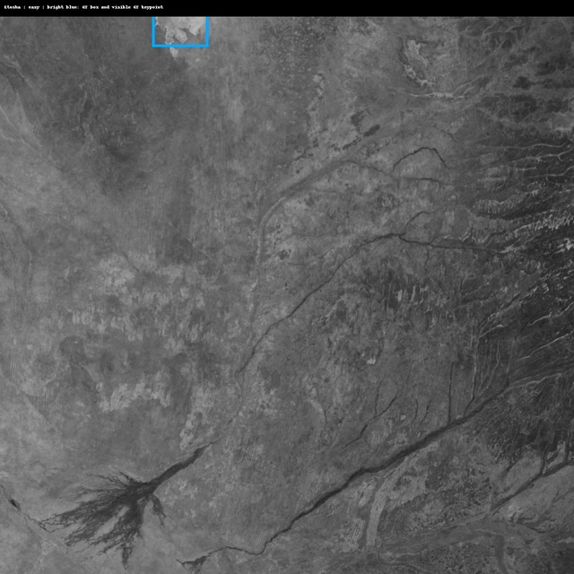
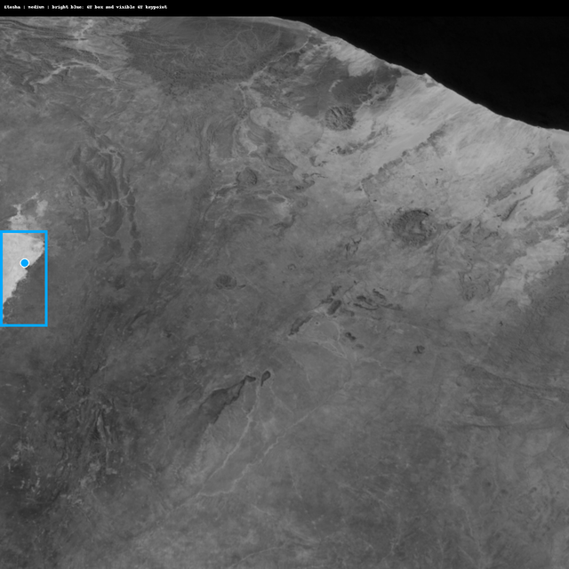
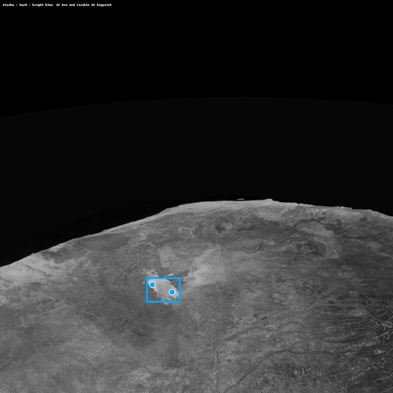
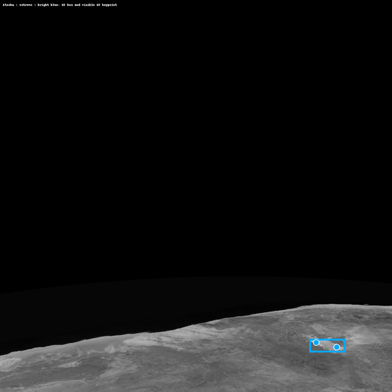

# 2026-10-23：Gray1 Pose 实验记录

## 目的

本次实验围绕灰度单通道（Gray1）关键点检测，重点验证两项改动：

1. 在原有 OKS pose loss 之外加入以模型输入像素为单位的 Smooth L1 坐标辅助损失。
2. 建立关键点像素误差的统计与可视化，便于直接观察预测坐标与标签坐标的偏差。

本记录对应分支 `lizhaojin/gray1-training` 的提交 `f8901e7`。

## 算法修改

### Smooth L1 坐标辅助损失

- 保留原有 OKS keypoint loss 与关键点可见性损失。
- 新增坐标辅助项：先将特征图坐标残差按金字塔 stride 换算到模型输入像素，再对 `dx`、`dy` 计算 Smooth L1。
- 默认 `beta=2.0 px`；坐标损失的默认增益为 `0.02`。
- 训练开始的前 5 个 epoch 不启用该项，随后用 15 个 epoch 的半余弦曲线逐步增大到目标增益，减少训练初期不稳定的影响。
- `results.csv` 与训练图中记录的是加权后的 `coord_loss`，即其对总优化目标的实际贡献。

### 训练与增强配置

- 默认训练输入由 1280 调整为固定 `640 x 640`；灰度输入仍为单通道。
- 支持设置 box、pose、kobj 和坐标损失的权重，以及早停 patience。
- 保持 HSV 与 BGR 颜色增强关闭；启用空间/混合增强：mosaic、mixup、上下/左右翻转、旋转、平移、缩放、错切、透视和随机擦除。
- 增加按难度逐步加入样本的 curriculum，以及周期性验证/测试可视化的控制参数。

### Difficulty curriculum（按训练 epoch 累积加入）

该功能默认关闭，使用 `--difficulty-curriculum` 后启用。样本难度从数据集 `metadata.csv` 的 `difficulty` 字段读取，取值必须为 `easy`、`medium`、`hard` 或 `extreme`；每次切换阶段时保留前一阶段样本，而不是替换掉它们。

| 训练 epoch | 参与训练的样本难度 |
| --- | --- |
| 1–10 | `easy` |
| 11–20 | `easy` + `medium` |
| 21–50 | `easy` + `medium` + `hard` |
| 51 及以后 | `easy` + `medium` + `hard` + `extreme` |

因此，代码当前不是“1–20 都是 easy”：第 11–20 个 epoch 已经会同时使用 `easy` 和 `medium` 样本。数据加载器仅在阶段边界切换，优化器状态会保留。

### Etosha 样例

以下是 `earth_gray1_00to19_xyz_opk_40000_view_difficulty` 数据集中的 Etosha test 样本，各取一个难度等级。预览图中，**亮蓝色框和圆点**分别是 GT bounding box 与可见 GT keypoint；这样可以直接看到 Etosha 在画面中的位置。

#### Easy：`landmark_00_etosha_easy_test_0001`

#### Medium：`landmark_00_etosha_medium_test_0001`

#### Hard：`landmark_00_etosha_hard_test_0001`

#### Extreme：`landmark_00_etosha_extreme_test_0001`

生成脚本为 `notes/generate_etosha_previews.py`。它读取被忽略的本机 `data/`，生成四张缩放到 `640 × 640` 的可提交预览图到 `notes/images/`；因此 GitHub 和团队成员也能直接看到本节图片。

## PX（像素）误差统计与可视化

- 主像素误差定义为每个关键点的 L1：`|dx| + |dy|`；其中 `dx, dy = prediction - ground truth`，坐标系为缩放后的模型输入图像。
- PCK 仍采用相对 GT 框对角线归一化的欧氏距离，与 L1 像素误差分开报告，不能直接比较数值。
- 验证过程按类别匹配预测框和 GT 框（默认 IoU 阈值 0.5），并按关键点置信度筛选。
- 记录整体和每个关键点的 L1 统计、`dx`/`dy` 分布、均值/中位数/P95、L2 参考误差及关键点覆盖率。
- 离线测试脚本支持 `--pixel-thresholds 1,2,3,5,10,20`，输出各阈值内的关键点比例，以及每张图、每个关键点的明细。
- `results.png` 扩展展示 `coord_loss`、L1/L2 像素指标和像素覆盖率。

## 数据集与实验脚本

- 新增 XYZ/OPK 数据集准备脚本：从源数据构建 Gray1 数据集，并按主地标分组、可复现地划分 train/val/test。
- 新增保留上游划分、smoke 数据集准备和上游数据到位后的准备脚本。
- 新增按 difficulty 评估 checkpoint 的脚本，以及 GPU 空闲时执行 epoch 120 难度评估的封装脚本。
- difficulty 评估分别输出 `easy`、`medium`、`hard`、`extreme` 四个测试子集的检测/姿态 mAP、L1 像素误差和关键点覆盖率。
- 新增 640 分辨率的训练 smoke test 脚本；脚本会检查 GPU 空闲状态、数据集验证标记和运行目录，避免误用已有输出。
- 仓库根 `.gitignore` 增加 `data/`，数据集本体不随本分支提交；提交的是生成/验证数据集的代码和配置。

## 后续实验建议

1. 在相同数据划分、随机种子和训练轮数下，对比关闭/开启坐标辅助损失的结果。
2. 同时记录 mAP、PCK、L1 mean/median/P95、L2 参考值和像素覆盖率，避免只看单一指标。
3. 分别检查不同地标及不同 difficulty 的误差分布，并保留对应 checkpoint、`args.yaml`、`results.csv` 与可视化图。
4. 在正式训练前先运行 smoke test；本笔记仅记录代码改动，不代表上述正式实验已经完成或得到结论。
