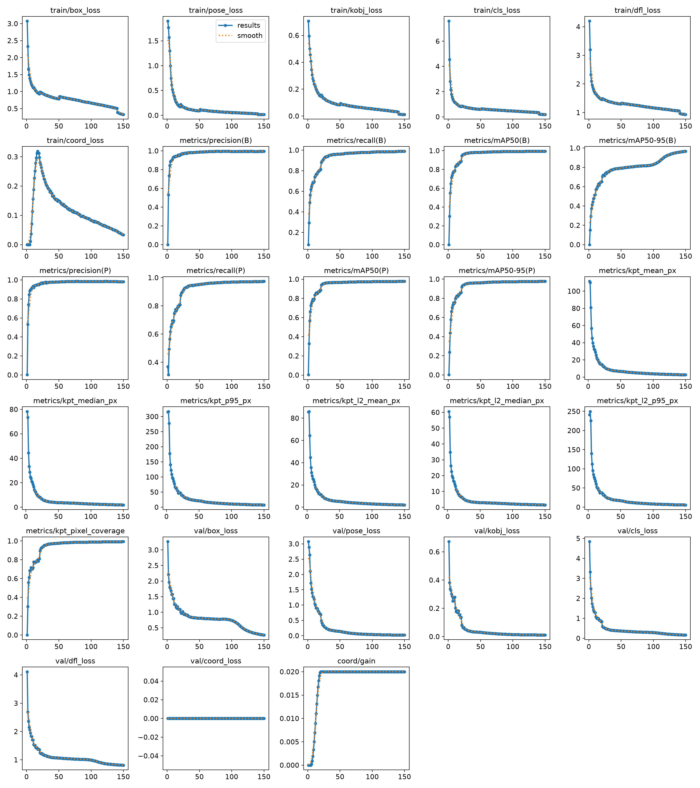
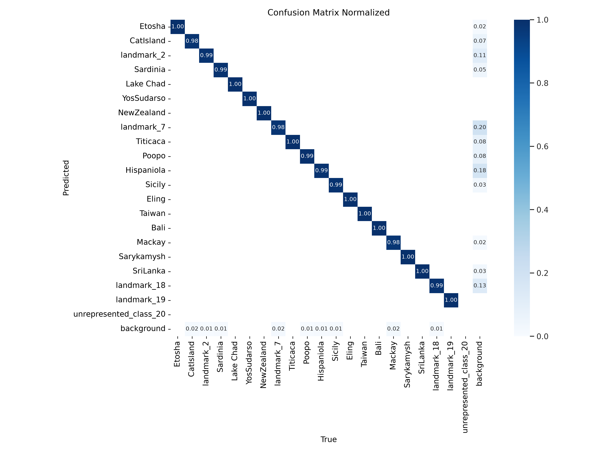
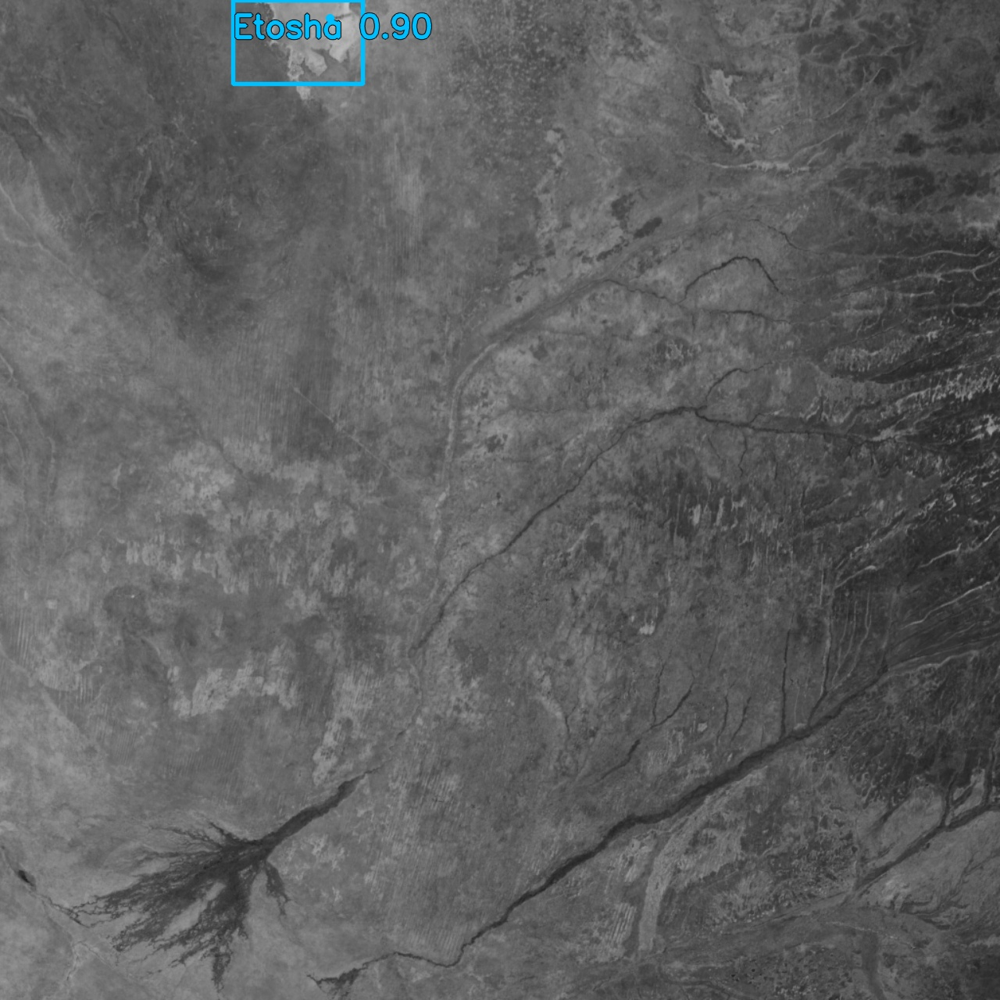
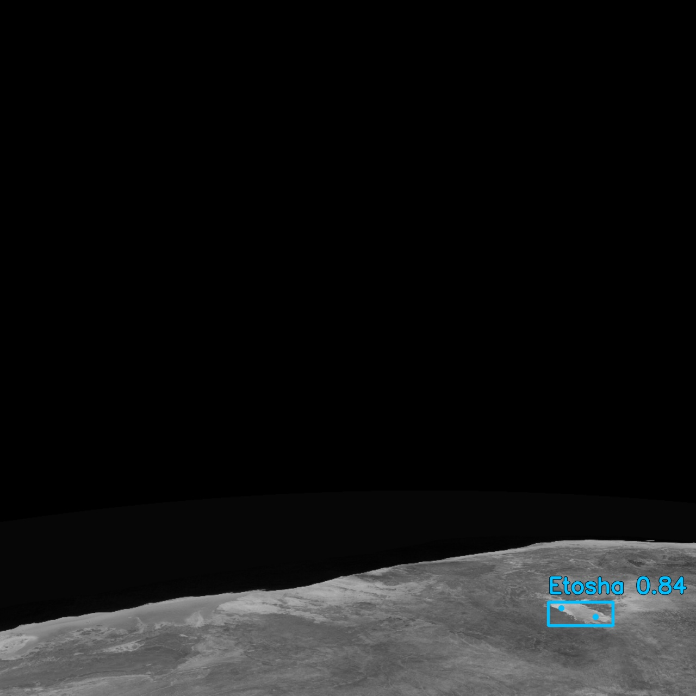

# 2026-10-26：40k Gray1 Pose 1280 Curriculum + Smooth L1 实验记录

## 1. 实验概览

| 项目 | 内容 |
|---|---|
| Run ID | `earth_gray1_40000_1280_b6_e150_pose30_curriculum_1to10_11to20_21to50` |
| 训练状态 | 已完整完成 150 / 150 epoch |
| 模型 | `yolov8x-pose-p6-gray1.yaml`，Gray1 单通道 YOLOv8x-P6 Pose |
| 输入 | 训练和验证均为 `1280 x 1280`、单通道灰度 |
| Batch size | 6 |
| 训练集 / 验证集 | 36,000 / 4,000 张；验证集为 upstream test 集 |
| 总耗时 | 208,183 秒，即 **57 小时 49 分 43 秒** |
| 平均耗时 | 1,387.89 秒 / epoch，即 **23 分 08 秒 / epoch** |
| 主关键点损失权重 | `pose = 30.0` |

本次是在 40k Gray1 XYZ/OPK 合成数据上的完整高分辨率训练。与 20k、640 baseline 相比，本 run 同时引入了三项变化：`1280` 输入、难度递进课程学习，以及绝对像素坐标 Smooth L1 辅助损失。因此结果可说明该组合方案的最终表现，但**不能单独归因**给其中任一项。

## 完整复现命令

以下为本次训练实际使用的启动命令。它显式写出全部训练参数，并把容器内数据路径固定为 `/dataset`。运行前必须先确认 `GPU_INDEX` 对应共享 H200 上确实空闲的 GPU。

```bash
REPO_ROOT=/home/ai-i-lizhaojin/Code/yolo-gray1-train
DATASET="$REPO_ROOT/data/earth_gray1_00to19_xyz_opk_40000_view_difficulty"
RUNS_ROOT="$REPO_ROOT/runs"
RUN_ID=earth_gray1_40000_1280_b6_e150_pose30_curriculum_1to10_11to20_21to50
RUN_ROOT="$RUNS_ROOT/$RUN_ID"
CONTAINER_NAME="gray1-train-$RUN_ID"
GPU_INDEX='<confirmed-idle-gpu-index>'
BATCH=6
TRAIN_IMAGE=yolo-gray1:1280-train-predict-20261016

test -f "$DATASET/VERIFIED"
test -f "$DATASET/dataset.yaml"
test -d "$DATASET/images/train"
test -d "$DATASET/images/test"
mkdir -p "$RUN_ROOT/experiments"
cp "$DATASET/dataset.yaml" "$RUN_ROOT/dataset.container.yaml"
sed -i 's|^path:.*|path: /dataset|' "$RUN_ROOT/dataset.container.yaml"

docker run --rm \
  --name "$CONTAINER_NAME" \
  --stop-timeout 30 \
  --gpus "device=$GPU_INDEX" \
  --user "$(id -u):$(id -g)" \
  --network none \
  --read-only \
  --shm-size 32g \
  --tmpfs /tmp:rw,nosuid,size=2g \
  -e HOME=/tmp \
  -e YOLO_CONFIG_DIR=/tmp/ultralytics \
  -e MPLCONFIGDIR=/tmp/matplotlib \
  -e PYTHONPATH=/workspace/src/Yolo_fine/ultralytics \
  -v "$REPO_ROOT/src/Yolo_fine:/workspace/src/Yolo_fine:ro" \
  -v "$DATASET:/dataset:ro" \
  -v "$RUN_ROOT/dataset.container.yaml:/config/dataset.yaml:ro" \
  -v "$RUN_ROOT/experiments:/experiments:rw" \
  --entrypoint python \
  "$TRAIN_IMAGE" \
  /workspace/src/Yolo_fine/train_yolov8x_p6_pose_gray1.py \
  --data /config/dataset.yaml \
  --model-config /workspace/src/Yolo_fine/configs/yolov8x-pose-p6-gray1.yaml \
  --epochs 150 \
  --imgsz 1280 \
  --batch "$BATCH" \
  --patience 0 \
  --box-gain 7.5 \
  --pose-gain 30.0 \
  --kobj-gain 1.0 \
  --coord-loss-gain 0.02 \
  --coord-loss-beta-px 2.0 \
  --coord-loss-start-epoch 5 \
  --coord-loss-ramp-epochs 15 \
  --pixel-metric-conf 0.25 \
  --pixel-metric-match-iou 0.5 \
  --pixel-metric-kpt-conf 0.5 \
  --mosaic 1.0 \
  --mixup 0.1 \
  --copy-paste 0.1 \
  --flipud 0.5 \
  --fliplr 0.5 \
  --degrees 10.0 \
  --translate 0.1 \
  --scale 0.5 \
  --shear 2.0 \
  --perspective 0.0005 \
  --erasing 0.2 \
  --no-multi-scale \
  --difficulty-curriculum \
  --device 0 \
  --workers 4 \
  --project /experiments \
  --name "$RUN_ID" \
  --save-period 10 \
  --val-plot-period 10 \
  --test-plot-period 20 \
  --plot-sample-stride 5 \
  --plot-min-images 10
```

容器只绑定一张 GPU，故训练脚本中的 `--device 0` 指向该卡；`--difficulty-curriculum` 会在容器可写的 `/tmp/gray1-difficulty-curriculum-dataset/` 生成阶段数据列表。训练完成后，参数快照和权重位于 `$RUN_ROOT/experiments/$RUN_ID/`。

## 2. 初始化与权重

模型入口：

```text
/workspace/src/Yolo_fine/configs/yolov8x-pose-p6-gray1.yaml
```

没有传入预训练 `.pt`，且 `resume: false`，故为**从零初始化训练**，不是 COCO 或三通道权重微调。`args.yaml` 中的 `pretrained: true` 是 Ultralytics 默认记录字段；实际初始化来源由 `model` 指向 `.yaml` 决定。

权重位于：

```text
experiments/earth_gray1_40000_1280_b6_e150_pose30_curriculum_1to10_11to20_21to50/weights/
```

- `best.pt`：199.15 MB，由 Box 与 Pose 的综合 fitness 选择；本次对应末轮的最高综合表现。
- `last.pt`：199.15 MB，epoch 150 的最后权重。
- `epoch100.pt` 至 `epoch140.pt`：每 10 epoch 保留的周期 checkpoint。

## 3. 数据说明与课程学习

数据集为 `earth_gray1_00to19_xyz_opk_40000_view_difficulty`，保留上游 train/test 划分；RGB 图像先按 BT.601 亮度转换为真实单通道灰度，再双线性缩放并保存为 `1280 x 1280`。

| 划分 | 图像数 | 标注对象数 |
|---|---:|---:|
| train | 36,000 | 42,610 |
| val | 4,000 | 5,214 |
| test | 4,000 | 5,214 |
| 合计（train + test） | 40,000 | 47,824 |

`val` 和 `test` 都指向 upstream test 图像，故它们不是两个独立的评估集；表中的 40k 合计按实际不重复的 train/test 样本计。

训练集难度分布为 easy 14,400 张、medium 7,200 张、hard 7,200 张、extreme 7,200 张；验证集相应为 1,600 / 800 / 800 / 800 张。课程学习采用累积式阶段：

| Epoch | 参与训练的难度 | 图像数 |
|---|---|---:|
| 1–10 | easy | 14,400 |
| 11–20 | easy + medium | 21,600 |
| 21–50 | easy + medium + hard | 28,800 |
| 51–150 | easy + medium + hard + extreme | 36,000 |

标签契约：21 个类别 ID（0–19 为实际地标，20 为未出现的占位类别）；每个目标有 2 个关键点，格式为 `(x, y, visibility)`；数据 YAML 声明 `channels: 1`、`input_semantics: gray1`、`kpt_shape: [2, 3]`。

## 4. 训练配置

### 损失与优化

| 项目 | 设置 |
|---|---:|
| box gain | 7.5 |
| pose / OKS gain | **30.0** |
| keypoint objectness gain | 1.0 |
| cls gain | 0.5 |
| DFL gain | 1.5 |
| Smooth L1 `beta` | 2 px |
| 坐标损失最终 gain | 0.02 |
| 坐标损失调度 | epoch 1–5 为 0；epoch 6–20 半余弦升至 0.02；之后保持 0.02 |
| 优化器 | `optimizer=auto`；按训练迭代数选择 SGD |
| 实际 SGD 参数 | `lr=0.01`、`momentum=0.9`、Nesterov |
| weight decay | 0.0005 |
| AMP | 开启 |
| early stopping | 关闭（`patience=0`） |

优化目标为：

```text
L_total = L_box + L_OKS(pose=30) + L_kobj + L_cls + L_DFL
          + lambda_coord(epoch) * L_SmoothL1_pixel
```

日志中的 `train/coord_loss` 是加权后对总目标的实际贡献；末轮为 0.03335。`val/coord_loss` 在该验证实现中为 0，不能将它解释成未加权 Smooth L1 的验证误差；绝对定位质量应以本 run 新记录的 L1/L2 像素指标为准。

### 图像增强

| 增强 | 设置 |
|---|---:|
| Mosaic / MixUp / Copy-Paste | 1.0 / 0.1 / 0.1 |
| 水平 / 垂直翻转 | 0.5 / 0.5 |
| 旋转 / 平移 / 缩放 / 错切 / 透视 | 10° / 0.1 / 0.5 / 2° / 0.0005 |
| HSV / BGR | 0 / 0 |
| Random erasing | 0.2 |
| Auto augment | `randaugment` |
| Multi-scale | 关闭 |

`close_mosaic=10`，因此训练末 10 个 epoch 关闭 Mosaic 相关混合增强以收尾。

## 5. 训练结果

### 最后一轮（epoch 150）验证结果

| 指标 | 数值 |
|---|---:|
| Box Precision / Recall | 0.99562 / 0.98921 |
| Box mAP@50 / mAP@50:95 | 0.99410 / 0.96746 |
| Pose Precision / Recall | 0.98144 / 0.97385 |
| Pose mAP@50 / mAP@50:95 | 0.97776 / 0.97738 |
| 关键点 L1 mean / median / P95 | **2.68138 / 1.90454 / 7.53873 px** |
| 关键点 L2 mean / median / P95 | **2.11264 / 1.50570 / 5.86379 px** |
| 关键点 coverage | **0.99302** |
| keypoint 0 L1 mean / median | 2.71226 / 1.94104 px |
| keypoint 1 L1 mean / median | 2.65024 / 1.86250 px |
| val box / pose / kobj loss | 0.26973 / 0.02235 / 0.01100 |
| val cls / DFL loss | 0.16393 / 0.81239 |

像素统计的单位为模型输入坐标系像素（本实验即 `1280 x 1280`）。统计仅纳入同时满足以下条件的可见 GT 关键点：预测框置信度 `>= 0.25`、同类框匹配 IoU `>= 0.5`、关键点置信度 `>= 0.5`。L1 是 `|dx| + |dy|`，L2 是 `sqrt(dx^2 + dy^2)`；coverage 是纳入统计的关键点占可见 GT 关键点的比例。

### 训练曲线

下图来自 `results.csv`，包含训练/验证损失、Box/Pose 指标、L1/L2 像素误差、coverage 和坐标损失调度。



### 混淆矩阵

归一化混淆矩阵显示 epoch 150 验证集上的类别匹配情况。



### Epoch 150 预测样例

以下两图来自周期性验证可视化，分别选取 Etosha 的 easy 和 extreme test 样本；叠加内容为模型预测框、类别和关键点，而非 GT 标注。

#### Easy：`landmark_00_etosha_easy_test_0001`



#### Extreme：`landmark_00_etosha_extreme_test_0001`



### 历史峰值

| 指标 | 峰值 | Epoch |
|---|---:|---:|
| Box Precision | 0.99624 | 78 |
| Box Recall | 0.98945 | 147 |
| Box mAP@50 | 0.99410 | 150 |
| Box mAP@50:95 | 0.96746 | 150 |
| Pose Precision | 0.98525 | 122 |
| Pose Recall | 0.97385 | 150 |
| Pose mAP@50 | 0.97776 | 150 |
| Pose mAP@50:95 | 0.97738 | 149 |
| 最低关键点 L1 mean | 2.68138 px | 150 |
| 最低关键点 L1 P95 | 7.53873 px | 150 |

### 结果解读

1. 末轮同时取得最高 Box mAP@50、Box mAP@50:95、Pose mAP@50、Pose Recall，以及最低的 L1 mean/P95、val box loss 和 val pose loss，说明在完整难度分布上训练至 epoch 150 仍在带来有效收益。
2. 在严格匹配和置信度筛选下，99.302% 的可见 GT 关键点进入像素统计；被纳入的关键点中，平均 L1 偏差为 2.68 px、中位数 1.90 px，P95 为 7.54 px。L1/L2 现已可直接量化绝对坐标精度，弥补仅用 OKS/mAP 无法反映绝对像素偏移的不足。
3. Phase boundary 后指标持续改善：epoch 50（尚未加入 extreme）L1 mean 为 6.73 px、Pose mAP@50:95 为 0.96314；引入全难度数据后至 epoch 150 分别改善到 2.68 px 和 0.97738。该趋势支持完整课程的后期联合训练是稳定的，但没有无课程对照，不能据此证明课程学习本身优于随机全量训练。
4. `best.pt` 的选择 fitness 为 Box 与 Pose fitness 的和，主要由二者的 mAP@50:95 加权决定；它不是以 L1/L2 最小为选择条件。本 run 恰好末轮也给出了最小 L1 mean/P95，若后续出现二者分歧，应按下游任务优先级另行选择 checkpoint。

## 6. 建议的后续对照

要识别这次提升来自数据规模、1280 分辨率、课程学习还是坐标损失，建议固定模型、种子、训练 epoch 和增强策略，分别补充：

- 40k、1280、全难度从 epoch 1 开始，但关闭课程学习；
- 40k、1280、相同课程学习，但 `coord-loss-gain=0`；
- 必要时增加 40k、640 的相同 recipe，量化分辨率带来的精度/时间权衡。

所有对照均应保留当前 L1/L2、coverage 和每关键点统计，并用相同阈值，以便可比。

## 7. 关键产物

- 参数快照：`experiments/.../args.yaml`
- 逐 epoch 指标：`experiments/.../results.csv`
- 曲线：`experiments/.../results.png`
- 最优权重：`experiments/.../weights/best.pt`
- 最后权重：`experiments/.../weights/last.pt`
- 周期性验证可视化：`experiments/.../periodic_visualizations/`
- 数据配置快照：`dataset.container.yaml`
